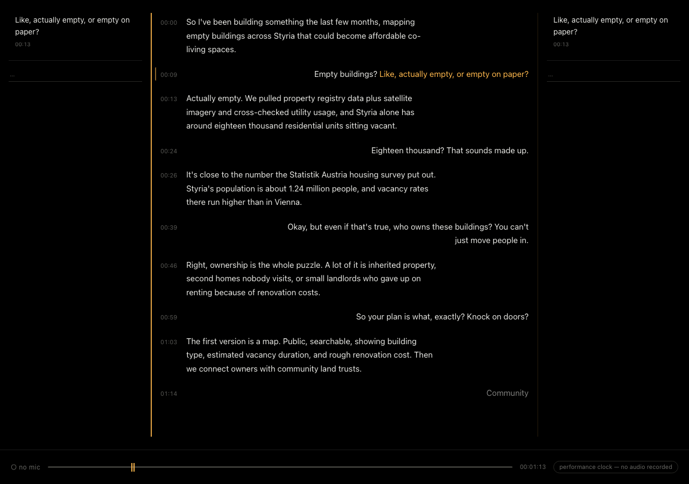

# talkweave

> Get the ready-made Mac app + personal support: https://trust-tech.app/talkweave.html.
> Source stays open; building it yourself stays free.
> What you pay for: the built app, updates and customer support.

> Status: beta / early access. Licensed under AGPL-3.0-or-later. Want a dual licence under AMPL? Reach out.

Talkweave augments a live two-person conversation without interfering. A transcript
grows in the center of a black screen, each person's speech aligned to their side.
While one person speaks, the other can flag the point just made with a single
keystroke, so it isn't lost by the time their turn comes. A local LLM (Ollama, never
leaving the machine) can extract the verbatim claim behind a flag, run quick and deep
fact-checks with a contradiction warning, and summarize the conversation on an
interval or on demand. Every session is a plain, human-readable markdown file, an
audio recording sits alongside it with full scrubbing support, and the whole thing
exports to one self-contained HTML file you can hand to anyone.



## Quickstart

```
npm install
npm run build
node server/server.mjs
```

Open http://127.0.0.1:8990. That single Node process serves both the built app and
its API, nothing else needs to run.

## Dev mode

Two terminals:

```
# terminal 1
npm run dev:server   # API server on http://127.0.0.1:8990

# terminal 2
npm run dev:app      # Vite dev server on http://127.0.0.1:5173, proxies /api
```

Develop against http://127.0.0.1:5173 for hot reload; the API server underneath is
the same one production uses.

## Desktop app

`~/Applications/TalkWeave.app` is a Tauri v2 shell (project in `desktop/`), not a
separate frontend or backend — it wraps the exact same Node server and built Svelte
app described above.

**How it works:** on launch, the shell checks `http://127.0.0.1:8990/api/health`. If
nothing answers, it resolves a Node binary (`TALKWEAVE_NODE` env override, then
`/opt/homebrew/bin/node`, then `/usr/local/bin/node`, then whatever `which node`
finds), spawns `node server/server.mjs` from its own bundled copy of `server/`,
`app/dist/`, and `landing/`, and polls health for up to 10s before showing a window
on that URL. If a server is already answering (e.g. you have `npm run dev:server`
running), the shell reuses it and never spawns or kills a server it didn't start
itself. On quit, it kills only the server process it spawned.

**Node requirement:** the shell does not bundle Node — it needs a Node binary on the
machine (Homebrew's `/opt/homebrew/bin/node` or `/usr/local/bin/node` cover the usual
case; set `TALKWEAVE_NODE` to point at a specific binary otherwise).

**Session files:** the desktop app always points sessions at
`~/Library/Application Support/TalkWeave/sessions` (via `TALKWEAVE_SESSIONS_DIR`),
not the repo's `sessions/` directory — that keeps the installed app working
independent of any repo checkout. To open that folder: `open ~/Library/Application\ Support/TalkWeave/`.
Server logs (both dev-mode and desktop-shell-spawned) go to
`~/Library/Logs/talkweave.log`.

**Migration:** if you have existing sessions under the repo's `sessions/` directory
from running the server directly, the desktop app will not see them and nothing
migrates automatically. Move them yourself if you want the desktop app to show them:

```
mv sessions/* ~/Library/Application\ Support/TalkWeave/sessions/
```

(the server always serves whichever `sessions/` root it's pointed at — running it
directly with no `TALKWEAVE_SESSIONS_DIR` set still uses the repo's `sessions/`, so
both roots keep working independently; this is a manual choice, not a requirement.)

**Building it yourself:**

```
npm run build                      # app/dist, if not already built
cd desktop && npx tauri build      # produces desktop/src-tauri/target/release/bundle/macos/TalkWeave.app
```

Then copy the resulting `.app` to `~/Applications/`. Run `cargo clean` in
`desktop/src-tauri/` afterward — the `target/` directory runs into the gigabytes.

**Microphone access:** first live-session recording in the desktop app prompts for
microphone permission (macOS reads `NSMicrophoneUsageDescription` from the app's
`Info.plist`); this hasn't been hand-verified end-to-end (agent verification runs
headless, no GUI) — expect the standard macOS mic-permission dialog on first use.

## Tests and checks

```
npm test              # vitest
npm run check         # svelte-check + TypeScript, app and server
npm run verify        # headless end-to-end demo verification (Playwright, builds
                       # the app, drives a real browser, screenshots the result)
npm run verify:mic    # headless live-transcription verification (see below)
```

`npm run verify`/`verify:mic` need a local Playwright install with a downloaded
Chromium build (a real `devDependency`, or an existing `npx`-cached one plus
`npx playwright install chromium`). Both look for it before running and print
exactly what's missing if it isn't found.

`npm run verify:mic` runs two things: a real-whisper live-mic check that SKIPS
gracefully (prints why, doesn't fail) if whisper.cpp isn't installed/no model is
downloaded on this machine, and a stub-whisper-binary pipeline proof that always
runs regardless — a real headless browser with a fake mic device captures real
audio, POSTs it to the real server, a small script standing in for `whisper-cli`
"transcribes" it, and the script asserts the result actually renders as a
transcript segment in the page. See [Live transcription](#live-transcription-v02)
below for what to install to make the first check stop skipping.

## Starting a conversation

The start screen offers two modes:

- **demo conversation**: replays a scripted ~36-turn fixture conversation at an
  adjustable speed (settings: 0.5x-8x), with no microphone or audio recording. Good
  for trying every feature (flags, fact-checks, summaries) without a live session.
- **live session**: starts recording audio immediately. With whisper.cpp installed
  and the "mic" engine selected (settings bar, `,`), the transcript fills in live —
  see [Live transcription](#live-transcription-v02) below. Without it (or with the
  "replay" engine still selected), the transcript stays empty exactly as in v0.1;
  flags, notes, and fact-checks still work and land on the audio timeline at the
  moment they happened, and the recording itself is fully scrubbable afterward.
  Past sessions (demo or live) are listed underneath and reopen exactly as they were
  left; reopening never re-records or re-replays automatically.

## Key map

All of these fire on the physical key regardless of layout, and are suppressed while
typing in a text field.

| Key | Action |
|---|---|
| `←` (ArrowLeft) | Set the current speaker to the left-hand person |
| `→` (ArrowRight) | Set the current speaker to the right-hand person |
| left `Shift` (alone) | Flag the point just made, attributed to the **left** person |
| right `Shift` (alone) | Flag the point just made, attributed to the **right** person |
| `Space` | Flag the point just made, attributed to whoever is **listening** (not currently speaking) |
| double-click a word/selection | Flag that exact span as the claim, attributed to the listener |
| `F` | Open the fact-check prompt |
| `,` | Pin/unpin the settings bar |

A flag with no local AI running still lands in the sidebar as "moment @t", nothing
is lost, it just has no extracted claim text yet.

## Features

- **Transcript**: live-growing, L/R aligned, amber left-border plus amber text on any
  flagged span, timestamp gutter that seeks the audio.
- **Flags & notes**: every flag lands in the flagger's sidebar with an excerpt and
  a jump-to-transcript button; free-text notes ("…" input at the bottom of each
  sidebar) attach a timestamped remark without needing a flag at all.
- **Summaries**: automatic on a configurable interval (default 15 minutes, 0 = off)
  or on demand ("summarize now" in the top bar), inserted as dividers in the
  transcript.
- **Fact-checking**: `F` opens a prompt pre-filled with the latest flagged claim,
  a quick pass answers in a few seconds, and a deep pass follows with an ETA (based
  on this machine's own recent deep-check timings) and a contradiction warning if
  the two disagree. Each result can be dismissed or kept; kept results pin into the
  flagging person's sidebar for the rest of the session.
- **Audio timeline**: live recording meter while a live session is running; in
  review mode (any session that has audio), a scrubbable timeline with markers for
  every flag, note, and fact-check, backed by real HTTP Range support so seeking is
  instant even on a long recording.
- **Export/share**: the "share" button in the top bar downloads a single
  self-contained HTML file (`GET /api/session/:id/export`) with the full transcript,
  highlights, notes, summaries, fact-checks, and the audio embedded inline (when
  under 25 MB). Open it anywhere, no server required.
- **Session files as markdown**: every session is `sessions/<id>/session.md`, plain
  text, readable and editable by hand. See the format sample below.

## Local AI (optional)

Talkweave's claim extraction, summaries, and fact-checks call a local
[Ollama](https://ollama.com) daemon at `http://127.0.0.1:11434`, never anything
off-machine. The app is fully functional without it: every AI-backed feature simply
degrades (a flag keeps its raw "moment @t" placeholder, summaries/fact-checks
silently no-op) and a "local AI offline" chip appears in the top bar.

Default models (configurable per-feature in the settings bar, `,`):

| Purpose | Default model |
|---|---|
| Claim extraction | `qwen3:4b` |
| Quick fact-check / summaries | `qwen3:4b` |
| Deep fact-check | `qwen3.6-27b-iq4:latest` |

Pull whichever models you configure with `ollama pull <model>` before starting a
session; nothing here downloads a model on your behalf.

## Live transcription (v0.2)

The "mic" engine (settings bar, `,`) fills the transcript live from your own voice,
via a local [whisper.cpp](https://github.com/ggml-org/whisper.cpp) `whisper-cli`
binary — no cloud call, ever, same local-only rule as everything else in this app.
Speaker attribution stays fully manual (ArrowLeft/ArrowRight, same as always) —
there is no automatic diarization; a manual speaker switch is itself what closes out
the current utterance and starts the next one.

### Install (one-liner)

```
brew1 install whisper-cpp
```

(`brew1` is this machine's wrapper that runs Homebrew as the `admin` user — see this
repo's `CLAUDE.md`/global config if you're on a different machine and just have
`brew`.) This installs `whisper-cli` on your `PATH`.

### Model download

Talkweave defaults to `~/Library/Application Support/TalkWeave/models/ggml-base.bin`
— the **multilingual** `base` model, deliberately NOT the `.en`-suffixed
English-only variant, since a real conversation here is German+English mixed.
Download it with either:

```
# whisper.cpp's own download script, if you built/cloned whisper.cpp separately:
bash ./models/download-ggml-model.sh base

# or directly from Hugging Face into the path Talkweave looks for:
mkdir -p ~/Library/"Application Support"/TalkWeave/models
curl -L -o ~/Library/"Application Support"/TalkWeave/models/ggml-base.bin \
  https://huggingface.co/ggerganov/whisper.cpp/resolve/main/ggml-base.bin
```

A larger model (`ggml-small.bin`, `ggml-medium.bin`, ...) trades speed for accuracy
— any `ggml-*.bin` dropped into that same folder (or this repo's own `models/`
directory, gitignored) is picked up automatically; see env overrides below to point
at a specific one.

### Env overrides

| Variable | Default | Purpose |
|---|---|---|
| `TALKWEAVE_WHISPER_BIN` | `whisper-cli` (resolved on `PATH`) | Path/name of the whisper.cpp binary to spawn. |
| `TALKWEAVE_WHISPER_MODEL` | `~/Library/Application Support/TalkWeave/models/ggml-base.bin` | Path to the `.bin` model file. Falls back to the first `models/ggml-*.bin` found in this repo if the default path is missing. |
| `TALKWEAVE_WHISPER_TICK_MS` | `1500` | How often (ms) the server re-decodes the current window. Raise this if real-world `whisper-cli` invocations run slower than the interval (see "Known limitation" below). |

### What the UI shows

`GET /api/whisper/available` reports `{available, bin, model, modelPresent}` —
`available` is the binary check, `modelPresent` the model-file check, kept separate
so the settings bar's "mic" option can tell you exactly what's still missing:

| State | "mic" option shows |
|---|---|
| `whisper-cli` not on `PATH` | disabled, "mic (whisper not installed — brew1 install whisper-cpp)" |
| binary found, model file missing | disabled, "mic (model missing — see README)" |
| both present | enabled, plain "mic" |

Selecting "mic" for a live session when whisper later turns out to be unavailable —
or if the whisper process/connection drops mid-session — degrades gracefully: a
"mic transcription offline" chip appears in the top bar and the session behaves
exactly like v0.1's live mode (recording keeps working, transcript just stays
empty), never an error or a crash.

### How it works (mechanism, for anyone reading the code)

`whisper-cli` has no live-stdin streaming mode, so this is a **sliding-window
batch re-decode**, not a persistent process: the browser downsamples/encodes mic
audio to 16kHz mono PCM16 (`app/src/lib/pcm_helpers.ts`) and POSTs small chunks to
`POST /api/mic/audio/:id`; the server (`server/lib/whisper_stream.mjs`) buffers
those into the current utterance's window and, on a ~1.5s tick, re-invokes
`whisper-cli` as a short-lived batch spawn over the WHOLE buffered window so far,
streaming the result back over `GET /api/mic/stream/:id` (Server-Sent Events) as a
`partial` event that REPLACES the previous partial's text (never appends — this
matches whisper.cpp's own "re-transcribes and rewrites its guess" streaming
behavior). A manual ArrowLeft/ArrowRight speaker switch immediately flushes the
window (one last re-decode, emitted as `final`) and starts a fresh one for the new
speaker; a 20s safety-valve cap does the same automatically if you never switch.

**Known limitation, not hidden**: spawning `whisper-cli` per tick reloads its model
from disk every time — real-time throughput at a ~1.5s cadence has not been
verified against the real binary on this machine (it isn't installed here; every
test in this repo runs against an injected stub or a small stand-in script). If
transcription visibly lags behind speech once you've installed the real binary,
the first thing to try is raising the tick interval, then a smaller model
(`ggml-tiny.bin`/`ggml-base.bin` over `ggml-small.bin`+); `whisper-cli`'s exact
command-line flags (`-m`, `-f`, `-nt`, `-l auto`) are also unverified against a real
install and are the first place to check if transcription runs but produces
garbled/empty text.

## Host/Origin guard

The server binds 127.0.0.1 only and checks every request first
(`server/lib/origin_guard.mjs`): Host must be `127.0.0.1` or `localhost`
(DNS-rebinding guard, else 421); no Origin, or its own origin, passes; any other
Origin gets 403. One deliberate exception (decision 2026-10-05): the live
TrustWeb site `https://app.idea2.site` may call only `/api/whisper/available`
and `/api/mic/*`, with CORS and Private Network Access preflight answers, so
TrustWeb can transcribe meetings through this TalkWeave. `TALKWEAVE_EXTRA_ORIGINS`
(comma separated exact origins) replaces that list for local experiments. The
`npm run dev:app` proxy strips Origin, so dev mode needs no exception.

## Session file format

Each session is `sessions/<id>/session.md`, plus `sessions/<id>/audio.webm` when a
recording exists. Example:

```
# Talkweave — Housing pitch
id: 20260822-101500
started: 2026-08-22T10:15:00.000Z
names: L=Jakob R=Alex
audio: audio.webm

## Transcript
- [0–5] L s1: Styria has about eighteen thousand vacant units.
  - flag f1 @6 by=R source=ai: eighteen thousand vacant units
  - note n1 @6.5 by=L: double-check this stat
- [5–8] R s2: That sounds made up.

## Summaries
- [0–8] sm1 interval: Discussed vacancy numbers.

## Fact-checks
- fc1 @6.5 by=R q: Is the vacancy number accurate?
  - quick (qwen3:4b, 850ms): Plausible per regional housing surveys.
  - deep (qwen3.6-27b-iq4:latest, done, contradicts=yes, eta=42000ms): Contradicts the cited 2022 report.
```

`sessions/` is git-ignored, nothing in there is meant to be committed.

## Landing page

A self-contained marketing/overview page lives at `landing/index.html` and is served
at [http://127.0.0.1:8990/landing](http://127.0.0.1:8990/landing) alongside the app,
with no build step and no external requests.

## License

AGPL-3.0-or-later. See `LICENSE`. Want a dual licence under AMPL? Reach out (connect@japossert.com). `LICENSES/AMPL-1.0.txt` ships as reference only. The AGPL-3.0-or-later option
is unambiguous and unrestricted (F-Droid-eligible). Talkweave is local-only:
no runtime network calls beyond `127.0.0.1` (Ollama and its own API server),
no telemetry, no CDN assets.
